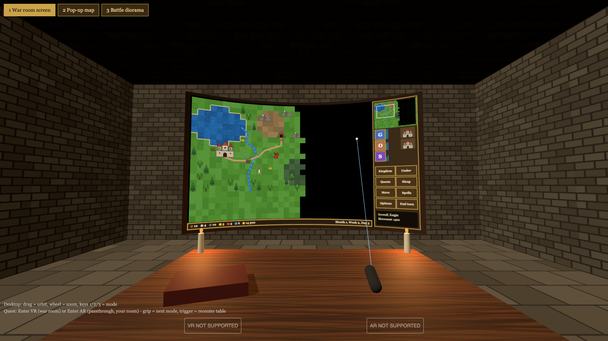
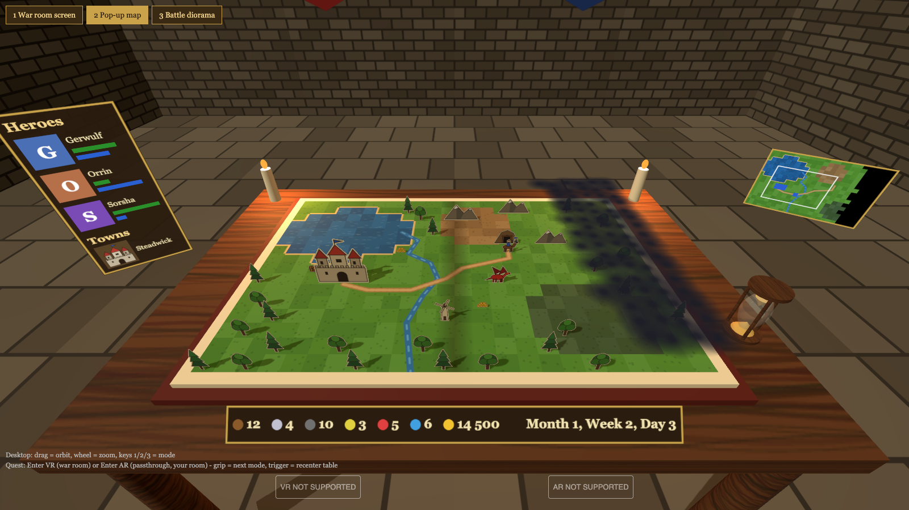
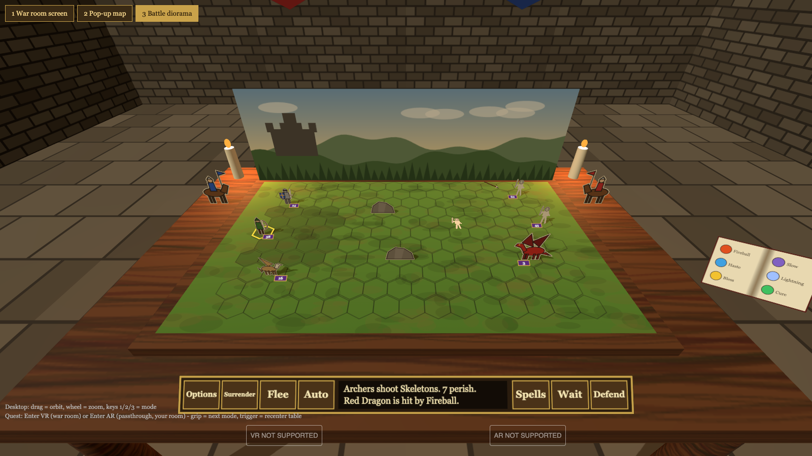

# VCMI for Meta Quest 3 - project plan

Native Quest 3 app (Android arm64, OpenXR). No PC streaming.
Goal: the most immersive way to play Heroes 3 on Quest 3, with no motion sickness.

## 1. Architecture and repository layout

A fork of [vcmi/vcmi](https://github.com/vcmi/vcmi): [bgaborg/vcmi](https://github.com/bgaborg/vcmi), branch `quest`.
The XR part is a [Godot](https://godotengine.org) 4 project. VCMI itself stays unchanged: no XR code in the VCMI C++ tree.

### How the two fit together

```
one APK, one Android process (is.xyz.vcmi.quest)
  ActivityLauncher (Qt, 2D panel)        upstream, unchanged except the Play hook
        | Play
        v
  VcmiXrActivity (Godot host)            NEW, quest flavor only
    Godot engine (godot-lib AAR) + godot_openxr_vendors (Meta)
      OpenXR session, 72/90 Hz, room, controller models, ray, recenter, haptics
      OpenXRCompositionLayerCylinder, use_android_surface = true
            | android.view.Surface
            v
    VirtualDisplay (private, owned by the app)
      VcmiSDLActivity                    upstream, unchanged: SDL + GLES draw the game into the display
            ^
            | MotionEvent / KeyEvent, dispatched directly (same process)
    Input bridge (Java, quest flavor)    ray hit -> hover / click / keys
```

- The game draws into an Android `Surface` that the OpenXR runtime owns (`XR_KHR_android_surface_swapchain`, used by Godot's `OpenXRCompositionLayer.use_android_surface`). No copy, no shared GL context, no XR code inside VCMI.
- Android allows an app to start its own activities on a private virtual display it created (`ActivityOptions.setLaunchDisplayId`). Meta's Spatial SDK shows Android activities in VR panels the same way.
- The compositor keeps 72/90 Hz even when the game draws nothing or stalls: Godot submits the frames, the game only updates the surface.
- Input: the bridge turns the ray hit into `MotionEvent`s (`SOURCE_MOUSE`, hover, buttons) and `KeyEvent`s and dispatches them to the game activity. SDL turns them into the same mouse and key events as on a phone with a mouse.

### Layout

```
vcmi/                        fork bgaborg/vcmi, branch `quest` (rebased on upstream `develop`)
  quest/                     project docs and tools (this file)
    concept/                 WebXR prototype (done, phase 0)
    xr/                      NEW  Godot project: scenes, GDScript; exported to a .pck at build time
    hdpack/                  NEW  PC tool: builds a VCMI HD mod from the user's own H3 data
    tools/                   build, install, log scripts
  android/vcmi-app/
    quest.gradle             NEW  flavor: godot-lib AAR, godot_openxr_vendors AAR, .pck as asset
    src/quest/               NEW  manifest, VcmiXrActivity (Godot host), virtual display, input bridge
  .github/workflows/quest.yml NEW  build + scheduled rebase check
```

### Rebase rules

The goal: `git rebase upstream/develop` has no conflicts in normal weeks.

1. New code goes only into new files: `quest/`, `android/vcmi-app/src/quest/`, `android/vcmi-app/quest.gradle`, `.github/workflows/quest.yml`.
2. No changes to VCMI C++ (`client/`, `clientsdl3/`, `lib/`, ...) for phases 1-3. A later phase that needs one adds a small generic hook and proposes it upstream first.
3. Every change to an upstream file is listed in the table below, is a few lines, and lives in one commit `quest: upstream hooks` at the bottom of the series, so conflicts can only land there.
4. A scheduled CI job rebases `quest` on `upstream/develop` every week and builds the APK; a failure is the signal to rebase by hand.

### Changes to upstream files (keep this list short)

| File | Hook | Why it cannot live in the flavor |
|---|---|---|
| `android/vcmi-app/build.gradle` | `apply from: 'quest.gradle'` (2 lines) | Gradle reads only this file |
| `ActivityLauncher.java` | Play starts the immersive activity if the flavor declares one (~15 lines) | the launcher starts `VcmiSDLActivity` by class |

To remove (phase 2 GLES spike, superseded): `clientxr/`, `ENABLE_OPENXR` in `CMakeLists.txt`, the XR code and the RGB888 / GLES 3.0 changes in `clientsdl3/render/ScreenHandler.cpp`, `VCMI_OPENXR`.

Remotes:

```sh
git remote -v
# origin    https://github.com/bgaborg/vcmi.git   (fork, branch `quest`)
# upstream  https://github.com/vcmi/vcmi.git      (rebase source, `develop`)
git fetch upstream develop && git rebase upstream/develop
```

### Why Godot and not own OpenXR code

The phase 2 spike drew the game through OpenXR from inside VCMI (`clientxr/`). It worked, but:
- each basic VR feature (controller models with a glTF loader, depth, lighting, recenter, cylinder layer, frame pacing) was new C++ and GL state handling inside the SDL renderer;
- it touched `ScreenHandler.cpp` and the game loop, which upstream changes often;
- days went into Horizon OS launch and layer problems with no engine to compare against.

Godot (MIT licence, GPL compatible) has these as nodes: OpenXR session and lifecycle, Meta controller models (`OpenXRFbRenderModel`), passthrough, hand tracking, cylinder composition layers, glTF scenes, spatial audio. Meta and W4 Games maintain the Quest support.

## 2. Constraints

- **License:** VCMI is GPL (see `license.txt`). The fork and the APK source must stay public under GPL.
- **Game data:** never ship H3 files. The user imports their own SoD / Complete / HD Edition data (existing launcher flow).
- **HD content:** see section 3. Never ship upscaled H3 art; ship only tools.
- **Threading:** VCMI renders on its own SDL thread into the virtual display; Godot renders the XR frame on its own thread. They share no GL context.
- **Comfort rules (acceptance criteria for every phase):**
  - The user's viewpoint never moves without the user's own head movement. No artificial locomotion and no camera glide.
  - World-locked content only. No head-locked UI except short system toasts.
  - Map moves only under direct hand control. Jumps to a hero use a fade, not a scroll.
  - No camera shake. Big effects flash or pulse the table.
  - Compositor at 72 Hz or higher, all the time, even when game logic stalls.

## 3. High-resolution graphics (HD)

### HoMM3 HD Mod and VCMI

- HoMM3 HD Mod (baratorch) patches the original `Heroes3.exe` (Windows, x86). Its main feature is high-resolution output of the original art, plus UI and multiplayer fixes. It cannot run on Quest.
- VCMI already gives the same result natively:
  - any output resolution
  - xBRZ upscaling, "similar in effect to HOMM3 HD mod" (`docs/players/Installation_iOS.md:65`)
- For Quest, the HD goal is: high-resolution output plus HD art, through the VCMI HD pipeline below.
- An H3 install with HD Mod still imports: VCMI uses the SoD / Complete data files. It does not use the HD Mod files.

### HD sources, in priority order

| # | Source | Format | Notes |
|---|---|---|---|
| 1 | VCMI HD mod packs | `sprites2x..4x`, `data2x..4x`, `video2x..4x`, `-shadow`, `-overlay`, player-colour variants ([`docs/modders/HD_Graphics.md`](../docs/modders/HD_Graphics.md)) | install with the launcher mod manager |
| 2 | Ubisoft HD Edition import | x2 / x3 DXT paks, core graphics only (`client/render/hdEdition/`) | the user must own HD Edition |
| 3 | Quest HD pack builder (new, `hdpack/`) | writes a VCMI HD mod (format of row 1) | runs on the user's PC with the user's own data; AI upscaler or xBRZ + sharpen; ship the tool, never the art |
| 4 | xBRZ runtime upscaling | `video.upscalingFilter`, `video.asyncUpscaling` | fallback for every image that rows 1-3 do not cover |

Loader order per image: `SPRITES{N}X/`, then `DATA{N}X/`, then the HD Edition pak, then upscaling of the base image (`clientsdl3/render/RenderHandler.cpp:486-498`). The maximum is 4x. Setting: `video.useHdTextures`.

### Resolution target per view

Quest 3 shows about 25 pixels per degree at the centre of the view.

| View | Distance | Target scale | Reason |
|---|---|---|---|
| War room screen | 2.4 m, panel ~63 deg wide | logical 1280x720, rendered at 2x | ~1600 px of panel detail is visible; 2x is sharper than the eye resolves |
| UI panels (resources, lists, dialogs) | 0.5-0.8 m | 2x | text must stay sharp; minimum font size setting |
| Tabletop map objects | 0.3-0.8 m | 4x | a 5 cm tile at 0.5 m is ~140 px on screen; base tile is 32 px |
| Tabletop terrain page | 0.3-0.8 m | 3x-4x | flat texture, mipmapped |
| Battle stacks and obstacles | 0.4-0.8 m | 3x-4x | stacks are seen close; needs `-overlay` for hover outline |

### XR-specific HD work

- **Mipmaps:** SDL_Renderer textures have no mipmaps. Godot builds mipmaps for the textures of the tabletop scene, so that distant objects do not shimmer.
- **GPU texture format:** the Quest 3 GPU (Adreno 740) supports ASTC and ETC2. It does not support BC / DXT. HD Edition DXT data is decoded to RGBA on the CPU today (`client/render/hdEdition/DdsFormat.cpp`, squish). For the 3D scene, transcode HD textures to ASTC one time and cache them on the device.
- **Memory budget per asset class:**
  - adventure objects at 4x
  - creature animations at 4x, loaded per battle
  - UI at 2x
  - preload the xBRZ cache for anything without HD art, so that it does not cause hitches at first use
- **XR graphics presets** (Low / High / Ultra) that set upscaling filter, HD texture use and scale per asset class.

## 4. Mods

### Original-exe mods and their VCMI equivalents

HD Mod, SoD_SP and the original Horn of the Abyss patch `Heroes3.exe` (Windows). None of them runs in VCMI, and none runs on Quest. Each one has a VCMI path:

| Original mod | What players want from it | VCMI path on Quest |
|---|---|---|
| HD Mod | high resolution | built in: any resolution, xBRZ, HD packs (section 3) |
| HD Mod | QoL hotkeys, army management | built-in key bindings (`config/keyBindingsConfig.json`): `heroArmySplit`, `exchangeArmyToLeft/Right/Swap`, `exchangeArtifacts*`, `townSwapArmies`, `townUpgradeGarrison`, `townOpenHeroExchange`, `battleAutocombat`; settings `quickCombat`, `stackRange`, `movementHighlightOnHover`, `showQueue`; mod `vcmi-extras` (Quick Exchange, Revisit / Search buttons, bonus and immunity icons, extended lobby) |
| SoD_SP | single-player bug fixes, extra options | no port. VCMI re-implements the rules, so it does not inherit many original bugs. Options come from game settings, the extended lobby (`vcmi-extras`) and small mods (`boost-ai`, `extreme-ai`, `tavern-invite`). Gap analysis task below |
| Horn of the Abyss | Cove, Factory, Bulwark towns, artifacts, skills, terrains, objects, campaigns | VCMI mod `hota` ([vcmi-mods/horn-of-the-abyss](https://github.com/vcmi-mods/horn-of-the-abyss)), type Expansion, CC BY-SA, assets by HotA Crew, version 1.8.005 when checked. VCMI reads HotA maps, including HotA event scripts (`lib/mapping/MapFeaturesH3M.h`, `HotaScriptConverter.h`) |

- The HotA installer for the exe game includes HD Mod. In VCMI, HD Mod is not needed, because the engine has these features built in.
- HotA campaigns: verify which campaigns load in VCMI (phase 1 test).

### Quest mod preset (candidates, test each in phase 1)

| Mod | Why on Quest |
|---|---|
| `hota` | new factions and content |
| `vcmi-extras` | HD Mod-style QoL (Quick Exchange, Revisit, Search, icons) |
| `hd-remastered` | 32-bit replacement art from ERA HD Edition. It ships `content/sprites` only (1x), so it improves the art, but it does not add HD scale |
| `hq-music`, `heroes3-extended-soundtrack`, `new-sfx-sounds` | audio quality; input for spatial audio |
| `vivid-battlefields`, `diverse-battlefields` | battle backdrops for the diorama |
| `h3-campaigns-remade` | campaigns |
| `heroes-o-pedia` | in-game reference; useful because a headset user cannot open a browser easily |
| `mmai` | ML battle AI (check CPU cost on Quest) |

Source: [vcmi-mods-repository `vcmi-1.7.json`](https://github.com/vcmi/vcmi-mods-repository/blob/develop/vcmi-1.7.json).

### Mod work in this project

- **QoL hotkeys in VR:** a keyboard is not available. Map the key bindings to controller input:
  - radial menu (`client/widgets/RadialMenu.cpp`, used for touch today) on a thumbstick press
  - two-hand gestures for army actions: grab a stack and drop it on a slot = move; drop with grip held = split
  - a hotkey panel on the wrist, with the most used bindings
- **SoD_SP gap analysis:** list the SoD_SP options that players use. For each one, record: VCMI setting, existing mod, or a new small mod (JSON only, if possible).
- **XR adventure layout:** the adventure UI is data-driven (`config/widgets/adventureMap.json`, `adventureMapPortrait.json`). Add `adventureMapXR.json`, which puts the named widgets (`minimap`, `heroList`, `townList`, `buttonEndTurn`, resource bar, ...) on separate XR panels.
- **Mod compatibility:**
  - UI mods (`new-interface-mod`, `vcmi-extras.adventureMap`) change the same widgets, so test the XR layout with them
  - HD packs and `hota` must work in tabletop mode, with card metadata for HotA objects

## 5. In-game popups and windows

All windows go through `WindowHandler::pushWindow` / `popWindow` (`client/gui/WindowHandler.h`). Today they draw into one screen.

### Window types and XR placement

| Type | VCMI classes (examples) | Placement in tabletop mode | Input |
|---|---|---|---|
| Hold popup (right-click info) | `CRClickPopup` family (`client/windows/InfoWindows.h`) | small panel 15-20 cm above the pointed object, turned to face the user (yaw only) | shows while grip is held, hides on release |
| Message / question | `CInfoWindow` (`showInfoDialog`), selection dialogs | panel in front of the table, about 0.7 m away, slightly below eye level; table dims (`backgroundDimLevel`) | ray + trigger; haptic pulse and sound on open |
| Large modal window | hero, town (`CCastleInterface`), exchange, market, kingdom, quest log, puzzle | large curved panel behind the table (same as the war room screen) | ray + trigger |
| Spellbook | `CSpellWindow` | book panel in the left hand | right-hand ray |
| Battle popups | stack / spell info | above the stack | grip hold |
| Status text / tooltips | status bar | table edge panel | none |
| Tutorial | `CTutorialWindow` (touch tutorial) | replace with an XR controls tutorial | ray + trigger |

### Rules

- All popups are world-locked. A popup outside the view shows a small direction cue at the view edge.
- A new window opens 5 cm in front of the previous one; older windows dim.
- Text: minimum font height setting; test readability at the panel distance.
- Text input (save names, chat): Quest system keyboard through SDL text input (verify on device).
- In screen mode (phase 3), popups stay on the main screen. No routing is needed.

### Implementation

- Phase 3 shows every window on the one game surface; no hook.
- Phase 4+: a `WindowHandler` hook draws each top-level window into its own offscreen target (`createOffscreenCanvas` exists), sent to Godot through the data bridge (phase 4). This is a change to VCMI C++, so it goes upstream first (section 1, rebase rule 2).
- Placement class per window type comes from a JSON file in the Godot project (`quest/xr/`). Unknown windows (for example from mods) fall back to the front panel.
- Input routing: the ray hits the panel; panel coordinates map to the window rect in logical screen coordinates; the existing event dispatch handles the rest.

## 6. Phases

### Phase 0 - Concept (done)

- WebXR mockup in [`quest/concept/`](concept/index.html): war room screen, pop-up book map, battle diorama, VR + AR.
- Result: the layout and the comfort model work on the headset.

| War room screen (Option 1) | Pop-up book map (Option 2) | Battle diorama (Option 3) |
|---|---|---|
|  |  |  |

Run on the Quest (WebXR needs HTTPS):

```sh
cd quest/concept
openssl req -x509 -newkey rsa:2048 -nodes -days 365 -keyout key.pem -out cert.pem \
  -subj "/CN=vcmi-concept" -addext "subjectAltName=IP:<lan-ip>,DNS:localhost"
python3 serve_https.py 8443
# Quest Browser: https://<lan-ip>:8443 -> accept cert -> Enter VR / Enter AR
# ?mode=screen|table|battle selects the start mode
```

### Phase 1 - Foundation

- Fork, branch, CI job for Android arm64 with the `quest` flavor.
- Run the current APK on Quest 3 as a 2D panel app.
- Check: data import on Quest, AI turn time.
- Mods: install the Quest mod preset (section 4). Test HotA towns, maps and campaigns, `vcmi-extras`, `hd-remastered`.
- SoD_SP gap analysis (section 4).
- HD check: install one VCMI HD mod pack and HD Edition data on Quest. Measure RAM, load time and frame time at 2x / 3x / 4x and with xBRZ only.
- **Exit:** a full game is playable in a 2D panel; a baseline is measured (FPS, RAM, AI turn time).

### Phase 2 - XR spike (done, superseded)

- Own OpenXR code in `clientxr/` on the SDL EGL context: the game on a quad layer, controller ray and boxes, clean exit, Horizon hybrid launch. Details in [`PHASE2.md`](PHASE2.md).
- **Result:** works, but every VR feature is new engine code inside VCMI, and the hooks sit in files upstream changes often. Decision: move to Godot (section 1). Keep the Android launch findings (real activity, not an alias; hybrid app categories).

### Phase 2b - Godot host spike

- Remove the spike code (section 1, "To remove"); the VCMI C++ tree is upstream again.
- Godot project `quest/xr/`: XR origin, camera, two controllers with `OpenXRFbRenderModel`, ray, `OpenXRCompositionLayerCylinder` with `use_android_surface`.
- `quest.gradle`: godot-lib AAR and godot_openxr_vendors AAR, both pinned; `make-apk.sh` and CI export the Godot project to a .pck with the Godot editor in headless mode and put it into the flavor assets.
- `VcmiXrActivity` hosts Godot (`GodotActivity` or `GodotFragment`). When the layer surface exists, it creates a private `VirtualDisplay` on it and starts `VcmiSDLActivity` on that display (`allowEmbedded`, `setLaunchDisplayId`).
- Input bridge: ray hit on the cylinder -> `MotionEvent` hover / buttons and `KeyEvent`s, dispatched to the game activity.
- **Exit:** the game plays on a curved screen with the real controller models and ray, 72 Hz with no judder while the game loads, clean exit; no change to VCMI C++.
- **Check early (day 1):** the virtual display launch on Horizon OS; SDL surface size and density on the display; text input (system keyboard) from a game on a virtual display.

### Phase 3 - War room MVP, release v0.1

All in Godot and the input bridge; no change to VCMI C++.
- Input: trigger = left click, grip = right click, thumbstick = arrow keys (map scroll), A/B/X/Y = keys from `config/shortcutsConfig.json`; hand tracking pinch as a second input method.
- Haptics: Godot pulses the controller on clicks and gamepad buttons and follows the game's "Haptic feedback" option (the game's own `hapticFeedback()` runs for touch input only, so no hook).
- QoL hotkeys on controllers: radial menu or a wrist hotkey panel in Godot that sends keys (section 4). Done: a wrist panel above the left controller, shown when it is turned to the eyes; the right ray and trigger press end turn, spells, kingdom, quests, sleep, dig, quick save and quick load, sent as the game's own keys (`config/keyBindingsConfig.json`). Godot does not know which screen is open, so the labels name the key: in battle D is defend.
- Popups stay on the main screen. The bridge sees clicks, not dialogs: haptics on click only until the data bridge exists.
- Environment: a low-poly war room (glTF scene in Godot) or passthrough, selected in settings. Done: passthrough (XR_FB_passthrough, alpha blend), switched by holding the left menu button for 0.6 s, saved in `user://screen.cfg`; a short press stays the game's options button.
- Seated / standing mode, recenter (Godot follows the runtime recenter event), screen distance, size and curvature settings (stored by Godot). Done: the left thumbstick sets distance (up / down, 1-4 m; the screen is a cylinder around the head, so a nearer screen curves more) and width (left / right, 1-4 m, at most 115° of arc), saved in `user://screen.cfg`; recenter works.
- Text readability: virtual display 2560x1440 or higher, cylinder compositor layer.
- HD: 2x assets for the screen and UI panels; XR graphics presets.
- **Exit:** a full campaign map is playable start to end in VR with no comfort complaints. Sideload release v0.1.

### Data bridge (decision before phase 4)

Phases 4 and 5 need game data, not pixels: terrain, object list, battle hexes and stacks. Options:
1. A small generic export hook in the VCMI client (`client/mapView/`, `client/battle/`) that passes the data through JNI to Godot. Proposed upstream first, so the fork carries it only until it is merged.
2. A GDExtension linked against `libvcmi` that reads the client game state through the existing callback interfaces (`CGameInfoCallback`), with one hook to get the callback.

Pick the option with the fewest changes to upstream files; prototype it on the minimap first.

### Phase 4 - Tabletop adventure map

- The 3D scene is a Godot scene in `quest/xr/`; the data comes through the data bridge.
- Terrain + river + road as a texture per region (no objects, no fog), drawn by VCMI into an offscreen target and passed to Godot.
- An object instance list: tile, sprite frame, animation, owner flag, z-order.
- Godot draws:
  - the map page as a flat textured mesh
  - objects as instanced paper cards (pop-up animation)
  - fog as a cloud layer, the path as discs
- Picking: the ray hits the table plane, then a tile; the tile goes to VCMI through the bridge (hover / click).
- Panel routing (section 5): resource bar at the table edge, hero / town lists on the left wrist, minimap as a small tablet, dialogs in front of the table.
- Controls: grab-drag the map, two-hand pinch zoom.
- Card metadata (height, anchor, fold style) from JSON, so mods can tune it. Include HotA objects.
- Army management gestures: grab / drop / split stacks.
- HD: 4x object cards and 3x-4x terrain page; Godot mipmaps and ASTC compression.
- **Exit:** the adventure map is fully playable on the table; the 2D screen fallback is available with one button.

### Phase 5 - Battle diorama

- Export through the data bridge: object, hex, `EBattleFieldLayer`, animation frame.
- Hex to world mapping in Godot (today hex to pixel is hard-coded in `BattleFieldController.cpp` ~924).
- Cards for stacks, obstacles, heroes. Corpses lie flat. Projectiles fly in 3D arcs. Effects are billboards (Godot particles).
- Battle UI on the table edge. Spellbook as a book panel in the hand.
- Battle popups above stacks (section 5).
- HotA creatures and battlefields (`hota`, battlefield mods) work as cards and backdrops.
- HD: creature animations at 3x-4x, loaded per battle, with `-overlay` and `-shadow` images.
- **Exit:** all battle types are playable, including siege walls and towers, with no regressions against the 2D battle.

### HD pack builder (parallel track, starts after phase 1)

- PC tool in `hdpack/` (Python, `uv`): reads the user's H3 data, upscales all sprites and images, writes a VCMI mod in the HD format.
- Produces `-shadow` and `-overlay` images, which flags and creature hover outlines need.
- Output check: compare with HD Edition art where it exists; reject results with visible artifacts.
- **Exit:** a full HD mod for SoD that loads on Quest with no xBRZ fallback for map objects and creatures.

### Phase 6 - Immersion

- Spatial audio: map ambient sources and battle sounds positioned on the table (Godot `AudioStreamPlayer3D`; needs the sound events through the data bridge).
- MR: snap the board to a real table (Meta scene and anchors through godot_openxr_vendors).
- Gestures: flip the hourglass to end a turn, grab a stack to split it.
- Town screen as a diorama or a wide curved panel.
- Co-located hot-seat / multiplayer with shared spatial anchors.

### Phase 7 - Release

- Performance pass: frame time, thermal, memory with 4x HD assets.
- Store or sideload decision; GPL compliance check; user data import flow on headset.
- Docs: build guide for the `quest` flavor, settings, comfort options.

## 7. Risks

| Risk | Impact | Mitigation |
|---|---|---|
| Horizon OS refuses or mishandles the game activity on a private virtual display | no picture | check on day 1 of phase 2b; Spatial SDK activity panels use the same Android mechanism; fallback: SDL draws into a `Surface` handed over by JNI (needs a VCMI hook) |
| Input dispatched to an activity on a virtual display: focus, hover, IME | missing hover, no text input | test in phase 2b; events dispatched directly in the same process; system keyboard check |
| Two engines in one process: RAM and CPU (Godot + SDL + server + AI) | slower AI turns, crashes with HD | measure in phase 2b against the phase 1 baseline; keep the Godot scene light |
| Godot XR APIs marked experimental (`use_android_surface`) change between versions | build breaks on a Godot update | pin the Godot and plugin versions; update on purpose |
| Pixels only until the data bridge exists | no tabletop before phase 4 | phase 3 is the full game on a screen; the bridge is a separate decision |
| CPU budget: AI (TBB) + server process + XR runtime | AI turns stall frames | limit AI threads; the Godot frame rate is independent of the game |
| RAM with HD assets and xBRZ | crashes | prefer pre-made HD assets; cap scale per asset class |
| Text readability | eye strain | compositor layer, high virtual display resolution, minimum font size setting |
| Upstream drift | rebase cost | rebase rules in section 1; weekly rebase CI; hooks proposed upstream |
| UI mods change the adventure widgets | XR layout breaks | phase 3 shows the 2D layout as is; data-driven layout from phase 4 |
| `hota` updates change content | missing card metadata | default card metadata for unknown objects |
| Store policy and GPL | no store release | sideload first; check policy before phase 7 |
| Quest GPU has no DXT support; RGBA HD textures use a lot of RAM | crashes, long loads | ASTC through Godot import; scale per asset class |
| HD packs cover only part of the art; xBRZ runs on the CPU | hitches at first use | preload the xBRZ cache; HD pack builder covers the gaps |
| Distributing upscaled H3 art violates copyright | legal | ship the builder tool only; the user runs it on their own data |

## 8. Open decisions

1. Data bridge for phases 4-5 (section 6): JNI export hook or GDExtension on `libvcmi`.
2. Passthrough or war room as the default environment.
3. Separate package ID (`is.xyz.vcmi.quest`) to install next to the normal Android build: recommended.
4. HD pack builder upscaler: AI model (quality, licence of the model) or xBRZ + sharpen (fast, no licence issue).
5. Upstream strategy: which hooks to propose to VCMI. The contributor opens the PRs (see [`AGENTS.md`](../AGENTS.md)).
6. Decided 2026-11-06: Godot hosts the XR part. The GLES vs Vulkan question of phase 2 is gone: the game keeps its own renderer.
